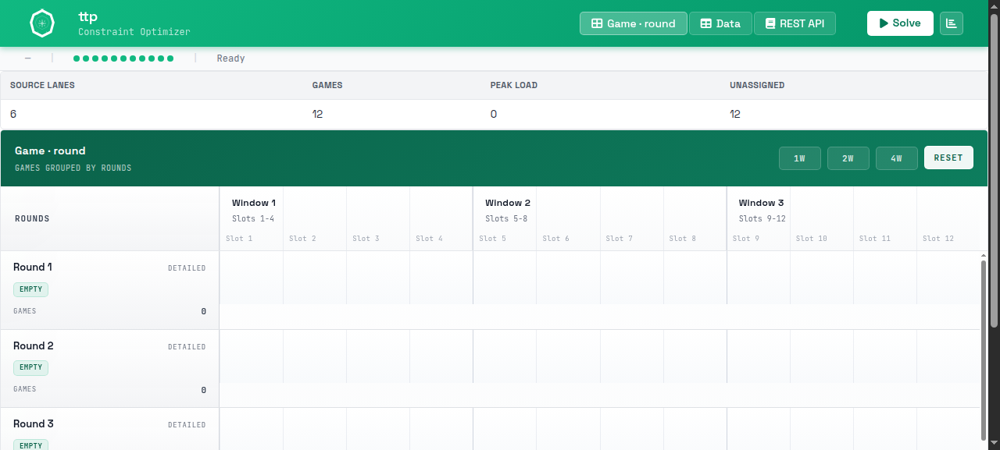
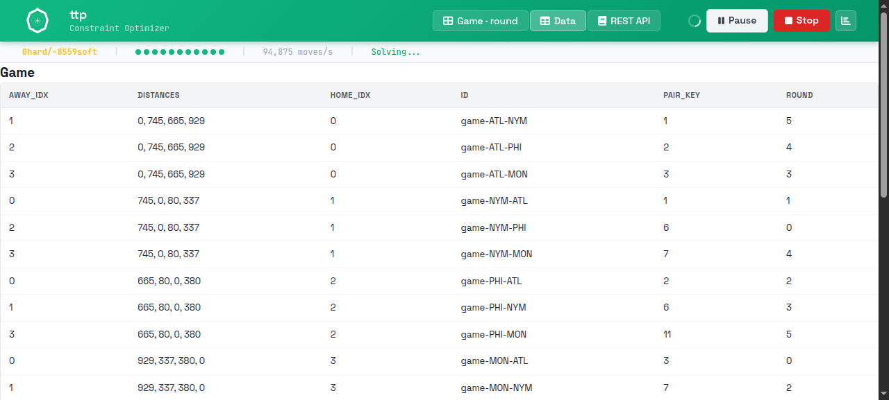
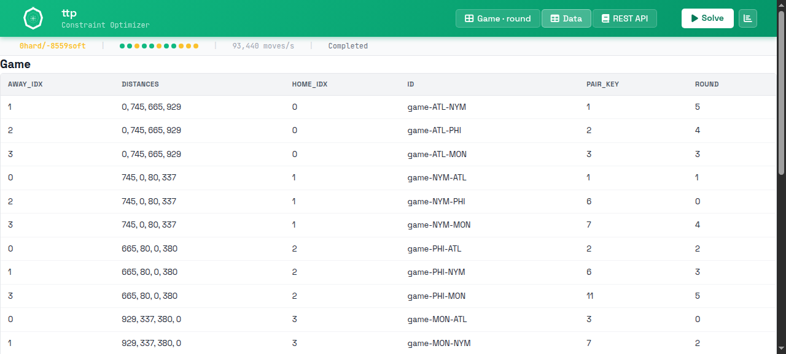

<p align="center">
  
</p>

# solverforge-ttp

**A solver workbench for the classic [Traveling Tournament Problem](https://www.robinxval.ugent.be/RobinX/travelRepo.php) (TTP(3)), modeled end-to-end on [SolverForge](https://github.com/SolverForge).**

The problem is deceptively simple and notoriously hard: the largest classic real-distance instance ever solved to proven optimality has **10 teams**.

## The problem

For a league of `n` teams (`n` even), schedule a **compact double round-robin tournament**: every team meets every other team exactly twice — once at home, once away — over exactly `2(n-1)` rounds, one game per team per round. Each team starts the season at its home city and must be back home after its last game.

Minimize the **total distance traveled by all teams** over the whole season. Teams travel smart: consecutive away games form *road trips* (direct legs between opponents' venues, no detour home), and *home stands* are consecutive home games with no travel at all.

Two realism rules (from the original 2001 definition):

1. **At-most constraint (C1)** — no home stand or road trip longer than `k = 3` games in a row.
2. **No-repeater constraint (C2)** — the same two teams may not meet in consecutive rounds (a game `(i,j)` is never immediately followed by game `(j,i)`).

The input is a symmetric `n × n` integer distance matrix. Everything else is the schedule. Easton, Nemhauser & Trick introduced the problem in *"The Traveling Tournament Problem: Description and Benchmarks"* ([CP 2001](https://doi.org/10.1007/3-540-45578-7_43)) while trying to schedule Major League Baseball — and failed thoroughly enough to create a research field. The field's state of the art through 2025/26 is collected in *"The Traveling Tournament Problem: An Overview"* (Van Bulck, Yang, Goossens & Trick, [arXiv:2609.03612](https://arxiv.org/abs/2609.03612)); the official instance repository and best-known tracker is [RobinX](https://www.robinxval.ugent.be/RobinX/travelRepo.php).

### Formal statement (TTP(k))

| | |
|---|---|
| **Input** | Teams `T` (even `n ≥ 4`), rounds `R` with `\|R\| = 2n − 2`, symmetric distance matrix `D`, max trip length `k` |
| **Output** | A compact double round-robin timetable |
| **C1** | Every home stand and road trip has length ≤ `k` |
| **C2** | No game `(i,j)` immediately followed by game `(j,i)` |
| **Objective** | Minimize Σ over teams of travel distance: the direct leg between consecutive venues, plus the legs from/to each team's home city at the season boundary |

This workbench models the canonical `k = 3` case (`MAX_RUN_LENGTH` in the code) on the NL benchmark set.

## What's inside

Modeled with [solverforge-cli](https://github.com/SolverForge/solverforge-cli) (web shell): a `Schedule` solution with the planning entity `Game` and the planning variable `round` per game.

```
Solution:   Schedule (HardSoftScore)
Facts:      teams  — immutable: distance-matrix row per team
            rounds — 2(n-1) round facts (the dynamic candidate range)
Entities:   games  — one per ordered meeting (i hosts j) / (j hosts i),
                     home side fixed by the load, pair_key = canonical pair id
Variables:  Game.round — scalar index into rounds (assignment mandatory)
Hard (feasibility):
  pair_no_repeater           |round(m_ij) − round(m_ji)| ≥ 2         (C2)
  home_double_booking        a team hosts ≤ 1 game per round
  away_double_booking        a team is away ≤ 1 game per round
  cross_side_double_booking  no home+away double-use of a round
  home_stand_limit           home stands ≤ 3 rounds (excess penalized)
  road_trip_limit            road trips ≤ 3 rounds (excess penalized)
Soft (objective, TR):
  travel_home_to_away        departure leg: home city → opponent venue
  travel_away_to_home        return leg:    venue → home city
  travel_away_to_away        direct leg between consecutive away venues
  first_round_departure      the season starts at home
  last_round_return          the season ends at home
```

Every constraint is one `ConstraintFactory` stream. The travel legs are directed cross-joins keyed on `(team, round±1)` tuples; the run limits group each team's home (resp. away) games and penalize consecutive-run excess over 3; distances ride with each game as its venue's fact row — constraints join over real data, nothing is precomputed as per-entity verdicts.

### Verification

- **Golden test** — the published Easton–Trick NL4 schedule is embedded (`instances::golden_nl4()`) and asserted to score **exactly `0hard/-8276soft`**, reproducing the proven optimum. A deliberately rotated schedule must score differently.
- **26 constraint unit tests** — one per rule with exact score-delta assertions covering violation / legal / unassigned cases.
- **Real solves** — `make sweep` solves the embedded instances through the HTTP API with per-job budgets and logs the gap against RobinX best-known.

### Screenshots

Loading `NL4` (12 games across 6 rounds, ready to solve):



The round-lane timeline shows the schedule structure while the solver runs:



Completed — `0hard/-8559soft` at 93,440 moves/s, all 12 games assigned:



## Benchmarks

The workbench embeds the classic **NL (National League)** instance class — real MLB air distances, double round-robin, compact, `k = 3`. Best-known values live at [RobinX](https://www.robinxval.ugent.be/RobinX/travelRepo.php); numbers below were fetched fresh from RobinX at README time (LB = lower bound; UB = best published solution; LB = UB ⇒ proven optimal).

| instance | teams | rounds | best LB | best UB | status |
|---|---|---|---|---|---|
| NL4 | 4 | 6 | 8276 | 8276 | optimal |
| NL6 | 6 | 10 | 23916 | 23916 | optimal |
| NL8 | 8 | 14 | 39721 | 39721 | optimal |
| NL10 | 10 | 18 | 59436 | 59436 | optimal |
| NL12 | 12 | 22 | 108629 | 115072 | open |
| NL14 | 14 | 26 | 183354 | 203407 | open |
| NL16 | 16 | 30 | 249477 | 271476 | open |

<!-- SWEEP_RESULT: measured with `SECONDS=120 make sweep` on the shipped
     solver.toml policy (move_thread_count = 8; diversified late acceptance +
     accepted_count 16; feasibility phase stops at 0hard; union
     change/swap/ruin-recreate; ruin 2-12 feasibility, 3-10 optimization),
     120 s per instance, random_seed = 1, SolverForge 0.23.0. -->

| instance | result | feasible | travel | gap |
|---|---|---|---|---|
| NL4 | `0hard/-8276soft` | yes | 8276 | **0.0% — matched the proven optimum** |
| NL6 | `0hard/-26419soft` | yes | 26419 | 10.5% |
| NL8 | `0hard/-47654soft` | yes | 47654 | 20.0% |
| NL10 | `0hard/-80328soft` | yes | 80328 | 35.2% |
| NL12 | `-3hard/-155968soft` | no | — | — |
| NL14 | `-7hard/-258690soft` | no | — | — |
| NL16 | `-6hard/-374277soft` | no | — | — |

Two honest readings:

- **NL4 lands on the published optimum exactly.** Construction plus a 120 s search reproduce the Easton–Trick value the golden test asserts — the model and the objective are right.
- **The 12–16 team instances plateau on the double-booking family** (`home_double_booking`, `cross_side_double_booking`): the residual is a near-perfect packing where fixing one team's double booking must not create another, and the phase exhausts its budget at the same state — identically with one and eight evaluator threads. That is a documented search-shape limit of the shipped policy, not a model defect; the per-job `duration_seconds` field is the budget knob and the sweep takes `SECONDS`.

### Multi-threaded evaluation

`solver.toml` sets `move_thread_count = { count = 8 }`: every local-search step evaluates its candidates on up to eight evaluators while one coordinator keeps the sequential acceptance order, so a run stays reproducible at fixed work. The same 120 s sweep with the line removed is the sequential control:

- **Best scores are identical** on all seven instances.
- **Feasibility phase** (best-of-16): 1–5% more evaluated moves on NL12–16 in the same budget.
- **Optimization phase** (first-accept): fewer consumed moves per second — e.g. NL10 evaluates 47,264 moves against 117,716 sequentially, because the evaluation window speculates past the first accepted move and discards the rest.

Remove the line for a sequential solve; the count is capped by the machine's Rayon pool.

## Quick start

```bash
cargo build --release
make serve                 # default PORT=7862; override with PORT=...
make solve INSTANCE=NL4 SECONDS=60
make sweep                 # all 7 embedded instances (SECONDS=60 default; the table uses 120)
make check                 # fmt + clippy + tests + solverforge check
```

REST API: `GET /demo-data` (catalog), `GET /demo-data/NL4`, `POST /jobs` with the plan JSON (add `"duration_seconds": N` for a per-job budget), poll `GET /jobs/{id}/status`, `GET /jobs/{id}/snapshot`. The UI is served at the server root.

## Development

```bash
# Add a new constraint
solverforge generate constraint my_rule --unary --hard

# Add a problem fact
solverforge generate fact resource --field category:String --field load:i32

# Add a domain entity
solverforge generate entity task --field label:String --field priority:i32

# Add a scalar planning variable
solverforge generate variable resource_idx --entity Task --kind scalar --range resources --allows-unassigned

# Or add a scalar over a non-negative half-open integer range
# solverforge generate variable hour --entity Task --kind scalar --countable-range 0..24

# Or add scalar hook metadata when your domain owns the hook functions
# solverforge generate variable resource_idx --entity Task --kind scalar --range resources --candidate-values resource_candidates

# Add an ordered list variable with optional current SolverForge metadata
# solverforge generate variable visit_order --entity Route --kind list --elements visits --domain cvrp

# Enable bounded candidate-pull diagnostics when needed
# solverforge config set candidate_trace.max_entries 100000

# Remove a resource
solverforge destroy constraint my_rule
```

| Directory | Purpose |
|-----------|--------|
| `src/domain/` | Planning entities, facts, and solution struct |
| `src/constraints/` | Constraint definitions (scored by the solver) |
| `src/solver/` | Solver service and configuration |
| `src/api/` | HTTP routes and DTOs |
| `src/data/` | Data loading and generation |
| `solverforge.app.toml` | Scaffolded app/domain contract |
| `solver.toml` | Solver configuration (termination, phases) |

## Runtime Diagnostics

Status, snapshot, and SSE payloads expose the complete compact SolverForge telemetry surface. Candidate pulls remain separate from ordinary control-plane traffic. After enabling `candidate_trace.max_entries`, use `GET /jobs/{id}/telemetry` for the atomically retained bounded trace and `POST /jobs/qualified` for externally attested qualified trace jobs.

## Versioning

- CLI version used to scaffold this project: `3.6.0`
- SolverForge runtime target for this scaffold: `solverforge 0.23.0`
- SolverForge UI target for this scaffold: `solverforge-ui 0.9.0`
- SolverForge maps target for this scaffold: `solverforge-maps 2.1.4`
- Runtime dependency currently wired into `Cargo.toml`: `crates.io: solverforge 0.23.0`
- Frontend UI dependency currently wired into `Cargo.toml`: `crates.io: solverforge-ui 0.9.0`
- Maps dependency currently wired into `Cargo.toml`: `crates.io: solverforge-maps 2.1.4`
- Scaffold shell: `web`

This project was scaffolded by `solverforge-cli`, and it currently targets `SolverForge crate target 0.23.0` through the configured crate dependency targets. Releases are cut with csemver (tag prefix `v`, version surfaces: package manifest + lockfile).

## References

1. Easton, K., Nemhauser, G., Trick, M. — *The Traveling Tournament Problem: Description and Benchmarks*. CP 2001, LNCS 2239 ([doi:10.1007/3-540-45578-7_43](https://doi.org/10.1007/3-540-45578-7_43)). Original definition and the NL instances.
2. Van Bulck, D., Yang, F., Goossens, D., Trick, M. — *The Traveling Tournament Problem: An Overview*. EJOR 2026 ([arXiv:2609.03612](https://arxiv.org/abs/2609.03612)). The modern survey: formal variants, lower bounds, approximation and exact algorithms; now maintains the field's bound tracking.
3. [RobinX — Minimum travel objective repository](https://www.robinxval.ugent.be/RobinX/travelRepo.php). Official archive of instances, bounds, published solutions, and the online validator. All embedded NL matrices are converted from its XML files.
4. Irnich, S. — *A new branch-and-price algorithm for the traveling tournament problem*, EJOR 204(2):218–228, 2010 ([doi:10.1016/j.ejor.2009.10.024](https://doi.org/10.1016/j.ejor.2009.10.024)). Branch-and-price proof of NL8 optimality.
5. Uthus, D.C., Riddle, P.J., Guesgen, H.W. — *DFS\* and the Traveling Tournament Problem*, CPAIOR 2009; *Solving the traveling tournament problem with iterative-deepening A\**, Journal of Scheduling 2012 — depth- and best-first search proofs of NL10 optimality.
6. Ribeiro, C.C., Urrutia, S. — *Heuristics for the mirrored traveling tournament problem*, EJOR 179(3):775–787, 2007.
7. Thielen, S., Westphal, S. — *Complexity of the traveling tournament problem*, Discrete Applied Mathematics 2011 (NP-hardness of TTP(3)); Zhao, J., Xiao, M. — APX-hardness for k > 2, 2025 (see the survey for the full complexity map).

*The mascot is **Trippo**: four emerald shell segments for the `k = 3`-bounded road trips and home stands, one suitcase because every venue is a destination, and a compass because the schedule is the map. Built with [SolverForge](https://github.com/SolverForge) by Vittorio Distefano (blackopsrepl).*

## License

[Apache-2.0](LICENSE)